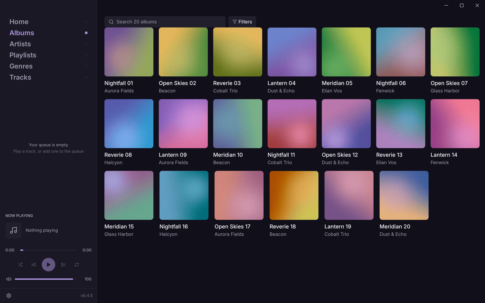

# Soul Player

**Your music. Your way. Your privacy.**

A desktop music player for people who still keep their own files.



## Why Soul Player

**Your library stays yours.** No account, no sign-in, no cloud. Your files never
leave your machine, and nothing about what you listen to is collected or sent
anywhere. The only thing the app talks to on its own is the update check, and you
can switch that off.

**It plays the file, not an approximation of it.** Gapless playback, no hidden
resampling, and exclusive access to your sound card where the platform allows it,
so the bits that reach your DAC are the bits in the file. The audio engine is
written from scratch rather than wrapped around someone else's.

**It feels native, because it is.** The whole interface is drawn on the GPU by
Rust code. There is no browser engine hiding inside it, so it starts fast, stays
small, and does not eat your battery to show a list of albums.

**Free, and staying that way.** Apache 2.0, no subscription, no paid tier, no
feature held back for a "pro" version.

## What it does

**Your library.** Point it at folders and it watches them. Browse by album, artist,
genre, or track, make playlists, search everything, and see your covers. Multiple
folders, remembered between launches.

**Playback.** Gapless, a proper queue, ReplayGain volume levelling, and loudness
and dynamic-range readings for the people who care about them.

**Sound shaping.** A built-in equaliser and a reorderable DSP chain, saved as
profiles you can switch between. Leave it all off and the signal path stays
untouched.

**Formats.** WAV, FLAC, MP3, MP2, MP1, M4A (ALAC), OGG, Opus, AIFF, WavPack, CAF,
MKA, WebM, and DSD (DSF and DFF). AAC is left out of the shipped build on purpose,
because decoding it needs a patent licence.

**Your own server.** `soul-server` serves your library to the player over the
network, sending the original files untouched. Your music on your machine at home,
reachable from your laptop, with nobody else's service in the middle. See
[Self-hosting](#self-hosting).

**The details.** Light and dark themes, six languages (English, German, Spanish,
Czech, Japanese, Chinese), media keys and your system's now-playing panel, and an
interface you can drive entirely from the keyboard.

Windows, macOS, and Linux. Phones are out of scope: this is a desktop player.

## Install

Grab the file for your system from the
[releases page](https://github.com/soulaudio/soul-player-ng/releases/latest).

- **Windows**: run the `-setup.exe` installer.
- **macOS**: open the `.dmg` and drag it to Applications. One download works on
  both Apple silicon and Intel Macs.
- **Linux**: `.deb`, `.rpm`, `.AppImage`, or a Flatpak bundle, for x86_64 and
  aarch64.

```sh
sudo apt install ./soul-player_*_amd64.deb              # Debian / Ubuntu
sudo dnf install ./soul-player-*.x86_64.rpm             # Fedora / openSUSE
chmod +x soul-player_*.AppImage && ./soul-player_*.AppImage
flatpak install --bundle ./Soul-Player_*.flatpak        # any distro with Flatpak
```

Linux needs glibc 2.35 or newer. Which formats update themselves, the distros we
test on, and the Flatpak sound-card permission are in
[docs/INSTALL.md](docs/INSTALL.md).

## Self-hosting

`soul-server` is a small server you run yourself. It indexes your music folders and
streams the original file bytes to the player, so a track played from across the
house sounds exactly like one played from the local disk. Logins go through the
standard OAuth flow in your browser, and accounts are ones you create.

```sh
cargo build --release -p soul-server
./target/release/soul-server --config soul-server.toml user add alice
./target/release/soul-server --config soul-server.toml serve
```

Setting it up properly, including running it as a service and putting it behind
HTTPS, is in [docs/SERVER.md](docs/SERVER.md).

## Contributing

Bug reports, fixes, and ideas are welcome. [CONTRIBUTING.md](CONTRIBUTING.md) has
the short version of how we work, and [CODE_OF_CONDUCT.md](CODE_OF_CONDUCT.md) the
short version of how we treat each other. Security issues go to
[SECURITY.md](SECURITY.md), not to a public issue.

## Under the hood

The rest of this is for people who want to read or build the code.

Soul Player is all Rust. The interface is [Rune], a GPU-rendered UI framework, with
no webview and no IPC between the UI and playback. Underneath it,
[`soul-audio-core`][core] is a from-scratch `no_std`, no-alloc,
`forbid(unsafe_code)` decode, resample, and playback library, built so the same
code could one day run on firmware rather than only on a desktop.

The rule the codebase keeps is that the UI is only visualization: every decision
about what to scan, what to play, and which cover to show lives below it, in code
that can be tested without a window.

| Path | Role |
|---|---|
| `crates/soul-player-backend` | Headless backend: Command/Event DTOs plus the `AudioPlayer` actor over the engine. Sink-generic, device-free. |
| `crates/soul-player-host` | The `PlayerHandle` waist the UI binds to: picks the audio sink, owns the live `Library`, fans backend events out. |
| `crates/soul-server` | The self-hostable remote-source server: indexes a library, authenticates, streams. |
| `app` | The native [Rune] UI head over `soul-player-host`. Its own workspace, on a pinned nightly. |

The engine, resampler, codecs, and the cpal sink come from
[`soul-audio-core`][core] as git dependencies; only the app-specific backend, host,
server, and UI live here.

### Build

The UI head is its own workspace on a nightly toolchain (pinned in
`app/rust-toolchain.toml`); everything else is stable.

```sh
cargo test                                 # backend + server
cd app && cargo build --release            # the player
```

On Linux the build needs a handful of system libraries (ALSA, D-Bus, OpenSSL,
xkbcommon, Wayland, xcb, a Vulkan driver). The list, the Nix shells, and how to run
the headless and desktop-session test suites are in
[docs/DEVELOP.md](docs/DEVELOP.md).

### Docs

| | |
|---|---|
| [docs/INSTALL.md](docs/INSTALL.md) | Package formats, glibc floor, self-update behavior |
| [docs/DEVELOP.md](docs/DEVELOP.md) | Toolchains, system deps, Nix, test suites, screenshots |
| [docs/SERVER.md](docs/SERVER.md) | Running Soul Server, and its wire protocol |
| [docs/ARCHITECTURE.md](docs/ARCHITECTURE.md) | How the layers fit together |
| [app/PACKAGING.md](app/PACKAGING.md) | Installers, code signing, auto-update, releases |
| [docs/adr/](docs/adr/) | Architecture decision records |

## License

Licensed under the **[Apache License 2.0](LICENSE)**: fully open source, free to
use, modify, and redistribute, including in commercial and closed-source products.
Copyright © 2026 datadir s. r. o. (Sebastián Stupák). See [LICENSE](LICENSE) and
[NOTICE](NOTICE).

### Why open source

We ship this in the open because we can get things wrong, and we'd rather you could
read it, fix it, and build on it than take our word for it. The whole point is to
let the community build on this effort instead of reinventing it. Fork it, learn
from it, make something better.

### Credit, a request rather than a requirement

If you build something on Soul Audio, we'd genuinely love a visible mention. Drop
this anywhere users can see it (an About / Credits screen, your docs, a footer):

> Powered by **[Soul Audio](https://github.com/soulaudio)**

It's a courtesy we appreciate, not a license condition. The name "Soul Audio" and
the logo are trademarks of datadir s. r. o. Please use them to credit us, not in a
way that implies we endorse your product.

[Rune]: https://github.com/anomalyco/rune
[core]: https://github.com/soulaudio/soul-audio-core
