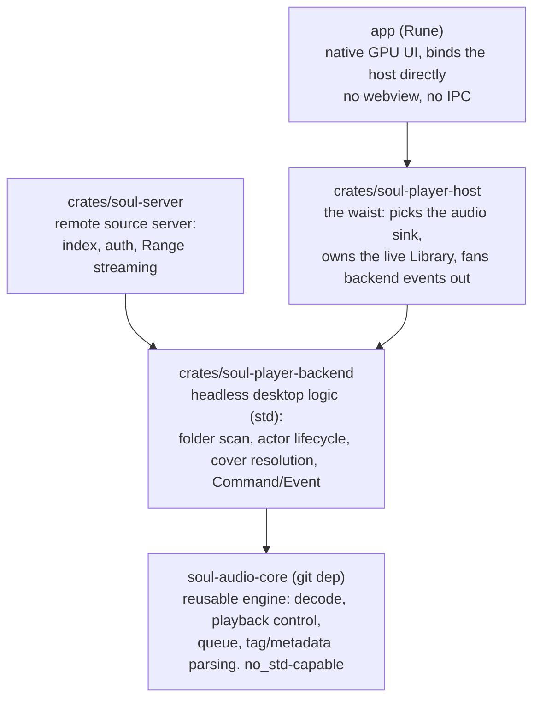

# Architecture

**Rule of thumb: the UI is just visualization. All logic lives outside it.**

## Layers

Two heads sit on the same headless stack: the desktop UI, and the server.

An arrow is a dependency: each layer may depend only on the ones below it. The
dependency direction is the architecture: `app` → `soul-player-host` →
`soul-player-backend` → `soul-audio-core`, and `soul-server` →
`soul-player-backend` → `soul-audio-core`. The UI reaches the backend **only**
through `PlayerHandle`, calling Rust methods directly, never by embedding logic
in the view.

`soul-server` skips the host: the host's job is owning an audio *sink*, and a
server has no speakers. It takes the same backend scan/catalog logic, wraps it in
its own hexagon (domain + ports, with HTTP as one inbound adapter), and serves the
untouched file bytes. See [SERVER.md](SERVER.md).

## Why

- **The service is headless.** It owns every decision (what to scan, what to
  play, which cover to show) and never touches a GUI toolkit. That keeps the
  logic testable without a window and portable off the desktop.
- **The core is reusable.** `soul-audio-core` is `no_std`-capable so the same
  decode/playback/tag code can run on firmware, not just the desktop app. Logic
  that could run there belongs in core, not in a platform crate.
- **The UI is a shell.** `app` exists to render and to drive `PlayerHandle`.
  If it starts making playback/library decisions, the boundary has leaked.

## Enforcement

| Boundary | How it's enforced | Where |
| --- | --- | --- |
| Service pulls in no GUI/windowing crate (`tauri`/`wry`/`tao`/`rune`/`wgpu`/`winit`/…) | `cargo deny check bans` (CI) + a `cargo test` architecture test | root `deny.toml` `[bans]`; `crates/soul-player-backend/tests/architecture.rs` |
| Service stays memory-safe | `unsafe_code = "forbid"` | root `Cargo.toml` `[workspace.lints.rust]` |
| The GUI stack lives only in the UI head | separate `deny.app.toml` (GUI crates allowed there only) | `deny.app.toml`, used by `app`'s `cargo deny` run |
| UI → host → service → core direction | Cargo path/dep graph (a reverse edge won't compile) | `Cargo.toml` manifests |
| Editing a playlist does not mutate the active queue (the queue is a decoupled snapshot) | `cargo test` architecture tests | `app` `views/playlist_detail.rs` (`editing_a_playing_playlist_does_not_mutate_the_queue`, `removing_...`) |

Keep the `FORBIDDEN` list in the architecture test in sync with `deny.toml`'s
`[bans].deny`.

## Migration roadmap (logic → core)

The goal is for all **reusable** logic to live in `soul-audio-core` (where it can
be `no_std` for firmware), leaving `soul-player-backend` as the thin std/desktop
adapter and `app` as pure visualization.

- **Already in core:** tag/metadata parsing (`soul-audio-tags`), decode,
  playback control, the queue.
- **Candidates to push toward core** (make the reusable parts `no_std`, keep the
  filesystem/platform parts in the service): cover-art *selection* logic (the
  embedded-vs-external decision, distinct from the `std::fs` lookup), and any
  library/track-model types that firmware would share.
- **Inherently platform (stays in the service/host):** recursive filesystem
  folder scanning and external-cover sidecar lookup (both are `std::fs`), and the
  `cpal`/actor sink lifecycle + event fan-out (in `soul-player-host`).
