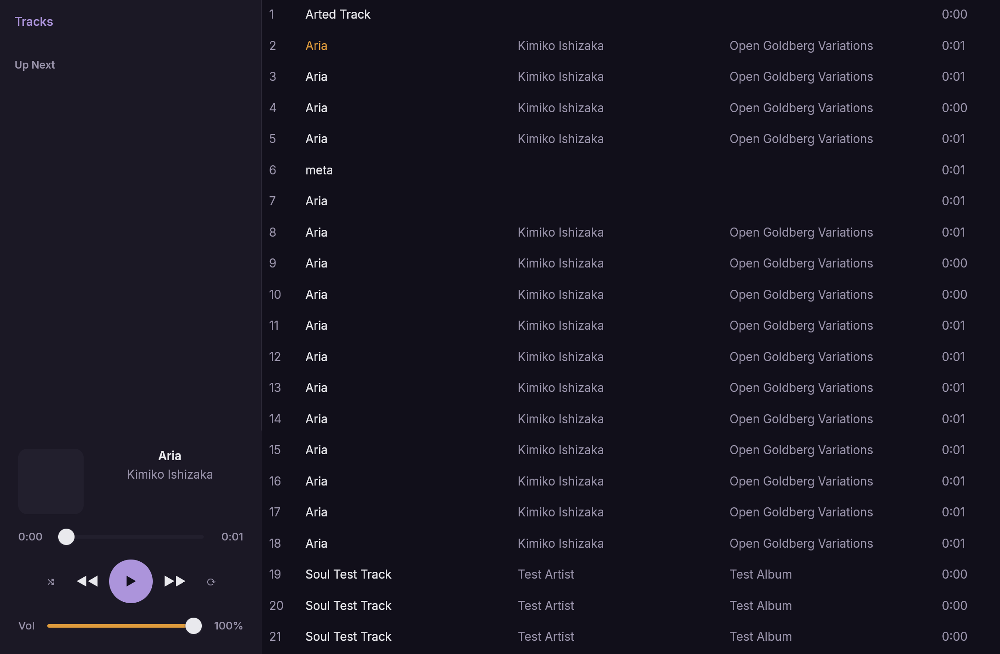
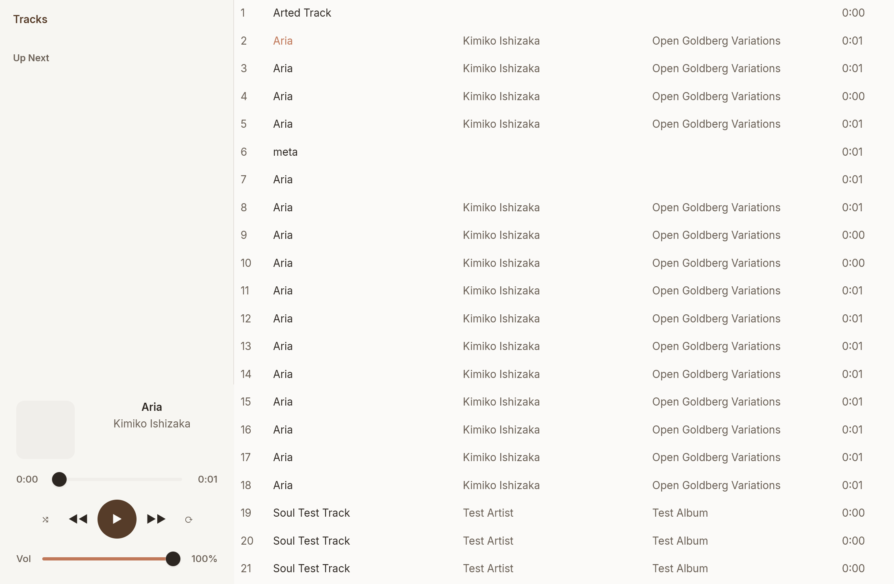

# Spike: Rune vs Tauri for soul-player

**Date:** 2026-11-08
**Branch:** `spike/rune-vs-tauri`
**Question:** Would [anomalyco/rune](https://github.com/anomalyco/rune) be a better UI foundation than Tauri 2?

## Verdict

**No — do not migrate now.** Rune is interesting and philosophically aligned
(all-Rust, webview-free), and our architecture would make such a swap unusually
cheap later. But Rune is pre-release, has no stable releases, ships no crates.io
package, and is explicitly *"written for agents, not you"* — it refuses human
pull requests. Betting a feature-complete, shipping desktop product on it today
would be reckless. Keep Tauri; put Rune on a watch list.

## What Rune is

- Native **GPU-rendered** Rust UI framework (macOS / Windows / Linux / web). Its
  own renderer — **no webview, no HTML/CSS/JS**.
- Built on solid Rust-GUI primitives: `wgpu` (GPU), `Taffy` (flex/grid/block
  layout), `Parley`/`HarfRust`/`skrifa`/`fontique` (text), `AccessKit` (a11y),
  plus its own spring-animation system.
- Declarative **Rust builder API**: `col()`, `el()`, `text()`, chained
  `.size()`, `.fill()`, `.on_press(|s: &mut State| …)`. State is a struct passed
  to a view fn. (No DSL/markup — it's Rust code.)
- Headless mode is the headline feature: render to PNG, dump the element tree,
  drive scripted input — aimed at AI coding agents.
- By **Anomaly** (team behind OpenCode). MIT.

### Maturity / governance red flags

- **Pre-release.** Instruction is literally "pin a rev of `dev`" — no semver, no
  tagged releases, not on crates.io.
- **"We don't take pull requests."** Contribution model is agent-driven issues.
  For a dependency under a product we ship, that is a serious supply-chain and
  longevity risk — we'd be pinned to one org's dev branch with no community
  fork-ability in practice.
- No published benchmarks of its own. (The widely-cited 76%→17% CPU /
  3.7GiB→440MiB numbers are **GPUI + a screen recorder (Cap)**, not Rune, and not
  a music player — a mostly-idle audio app sees far smaller webview savings.)

## Why the question is reasonable for *this* repo

Our layering already isolates the UI, which is exactly what a renderer swap
needs:

| Layer | Crate / dir | Swappable? |
|---|---|---|
| Engine (decode→resample→playback, `no_std`, `forbid(unsafe)`) | `soul-audio-core` (git dep) | Keep as-is |
| Headless backend actor — Command/Event **DTOs**, sink-generic, device-free | `crates/soul-audio-service` (`types.rs`, `driver.rs`, `actor.rs`) | **Keep as-is** |
| Shell: wires cpal sink + service | `app/src-tauri` | Replaced |
| UI (webview) | `app/` Svelte 5 + Vite | Rewritten |

Because the service is already a transport-agnostic actor over Command/Event
DTOs, a native-Rust UI could sit directly on it — arguably *more* naturally than
the current IPC-to-webview bridge. The engine and all audio logic are untouched
by any UI choice. This is the one genuinely attractive angle.

## Cost / risk of switching today

- **Rewrite the entire feature-complete UI** (library scan, gapless playback,
  seek, volume, cover art) from Svelte 5 into Rune's Rust builder API.
- **Throw away the Tauri ecosystem we already depend on:** configured updater,
  NSIS + macOS installers/signing, WebView2 bootstrapper, plugin ecosystem.
- **Invalidate the e2e suite** — `app/e2e` is DOM-based wdio/Edge WebDriver;
  there is no DOM in Rune. (Rune's element-tree + headless PNG is a plausible
  replacement harness, but it's a from-scratch rewrite.)
- Pin production to an unversioned `dev` rev of a no-PR project.

## Benefits we'd actually get

- Drop the WebView2/WebKitGTK process → lower idle memory; one renderer across
  all OSes (kills the WebKitGTK-on-Linux inconsistency that bites Tauri apps).
- Single-language (all-Rust) stack — aligns with the repo's Rust-purist stance
  (`forbid(unsafe)`, `no_std` core).
- GPU-accelerated animation/springs.

For a music player these are real but modest; the webview tax is much lower here
than for a video/screen-recording app.

## If we ever go webview-free, Rune isn't the only option

More mature native-Rust peers to weigh first: **GPUI** (powers Zed), **Slint**,
**Xilem** (linebender), **Dioxus** (native renderer), **Floem**, **egui**. Most
have releases, semver, and open contribution — all things Rune currently lacks.

## Recommendation

1. **Stay on Tauri 2 + Svelte 5.** The product is feature-complete; the upside
   doesn't justify a full UI rewrite onto pre-release infra.
2. **Keep the service boundary clean** (it already is) so a native UI is a
   low-regret future option regardless of which framework wins.
3. **Watch Rune** for: a tagged/crates.io release, an open contribution model,
   and real published benchmarks. Revisit if all three land — and benchmark it
   against GPUI/Slint/Xilem at that point rather than adopting by default.

---

# Measured results — we built the Rune head

The above was written *before* building. We then built a real Rune UI head
(`app/rune`, on branch `spike/rune-vs-tauri`) over the shared `soul-player-host`
`PlayerHandle`: a single-screen player mirroring the old `soul-player`
sidebar-centric layout. Rune pinned to dev rev `07c369b`.

## What got built (and it works)

A complete sidebar-centric player: 288px left sidebar (nav label → Up-Next queue →
player panel: cover art, title/artist, hand-built seek bar, 5-button transport,
volume) + a scrollable library track list in the main area, **Day + Night themes
switched by system appearance** using the old app's exact palettes. Verified
end-to-end via Rune's headless `--snap` PNGs (both themes):

## Feasibility: proven on Windows

- **Compiles** (257 crates, Rust 1.99.1) and **renders** (wgpu offscreen; GPU
  init ~1 s, first frame ~16 ms) — no hard blockers.
- **The scariest risk — ingesting the backend's ~8 Hz `Tick`/`Queue` events from
  another thread — was a one-liner:** `AppHandle::update(|s, tx| { s.apply(&ev); })`
  called straight from the host's `subscribe` callback. The clean service
  boundary made the whole head a ~1-session spike.
- **Cover art** takes the backend's encoded bytes directly (`ImageCache::load_mime`),
  no manual decode.

## The numbers

| Metric | Rune head | Tauri + Svelte head |
|---|---|---|
| UI source | **887 LOC** Rust (`app/rune/src`) | **1009 LOC** Svelte + TS (`app/tauri/src`, excl. tests/bindings) |
| Binary | 42 MB debug, **self-contained** (no runtime dep) | ~10 MB exe **+ system WebView2** runtime |
| Renderer | one GPU renderer, identical on every OS | OS webview (WebView2 / WebKitGTK — diverges per-OS) |

Notably the Rune head is *less* code than the Svelte UI despite hand-building the
sliders, theme system, and cover-art cache that the webview gets for free from
CSS/the browser. (Release binary size not measured — the release build is heavy;
expect it well under the debug 42 MB after strip/opt.)

## The friction (the real cost of a pre-release dep)

- **No stable API/docs** — every task had to read the cloned `examples/` to get
  the real API; several naive guesses were wrong.
- **sRGB gotcha:** `rune::Color` is *linear*; the obvious `hex/255` conversion
  rendered visibly washed-out until routed through Rune's own `color::hex`.
- **No `Slider` widget** — hand-built from the `examples/settings` pattern (worked
  well, but it's real code + a fixed-width quirk to tidy).
- **`rune-kit`'s `List` isn't a library browser** — used a plain `.scroll`ed
  column (`.virtualize` is the path for large libraries; noted in code).
- **MSVC `LNK1140`:** Rune's huge dep tree overflowed the debug program-database
  limit; fixed with `[profile.dev] debug = 0`.
- **Windows is a secondary target** — we were first to hit the PDB issue; builds
  are heavy (multi-GB target, ~15 min first build; our dev disk filled during
  iteration) and need a newer toolchain pin (`1.99.1`).
- **Still unversioned, single-branch, no-PR** — the governance risk is unchanged.

## What's genuinely good

The view → diff → spring model is ergonomic; **headless `--snap` PNG +
element-tree is first-class** (we verified the entire UI from snapshots, exactly
the agent-driven loop Rune pitches); one renderer means pixel-identical output
across OSes; the all-Rust stack fits the repo's ethos.

## Updated verdict

Building it **confirms "stay on Tauri for now"** — the pre-release API friction,
no-PR governance, Windows-secondary rough edges, and heavy builds are real costs
for a *shipping* product. **But it also de-risks Rune as a future option:** it's
genuinely capable, the port is ~1:1 in LOC, and the headless-snapshot workflow is
excellent. Keep `app/rune` in-tree as a reference head; the clean `soul-player-host`
waist means we can revisit cheaply if/when Rune ships releases + open contribution.
